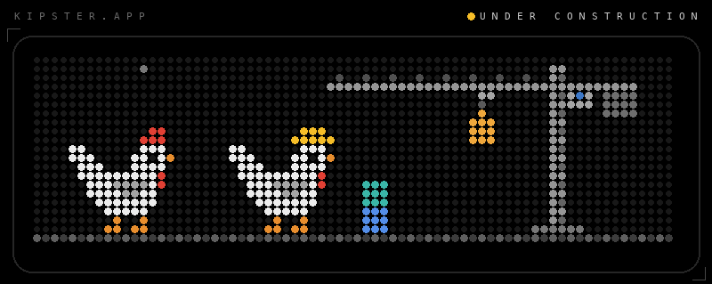
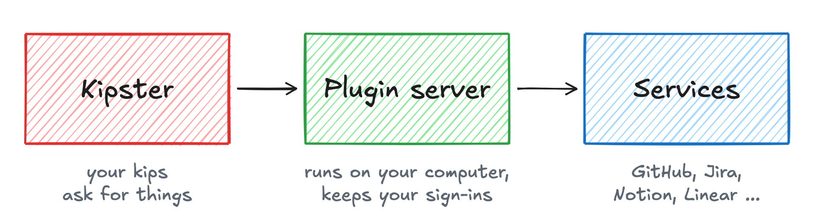
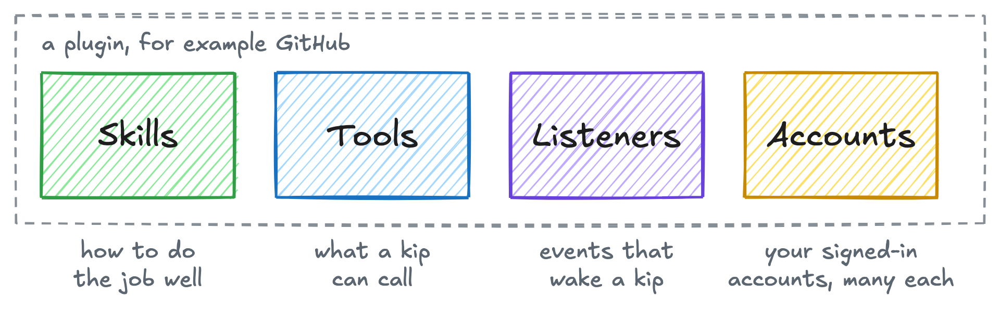

  

  <b>Plugins for your kips.</b> 
  Connect your kips to the services you already use.

  <b>Under construction.</b> Nothing here is ready to use yet.

## What is Kipster Plugins

[Kipster](https://github.com/manikanta-kops/kipster) gives you personal AI agents
called kips. Kipster Plugins lets them work with the services you use, such as
GitHub, Jira, Notion and Linear, through your own accounts.

The plugin server runs on your own computer, next to Kipster. Your sign-ins stay
there, and nothing passes through a Kipster server.

## How it fits

<picture>
  <source media="(prefers-color-scheme: dark)" srcset="docs/assets/how-it-fits-dark.png">
  
</picture>

- **Kipster** is where your kips live. They ask the plugin server for what they need.
- **The plugin server** holds your plugins and signed-in accounts, and talks to each service.
- **Services** are the apps you already use. Most offer an official MCP server that
  the plugin server connects to.

Kipster bundles and starts the plugin server. You can also run it on its own.

## Every plugin has four parts

<picture>
  <source media="(prefers-color-scheme: dark)" srcset="docs/assets/plugin-parts-dark.png">
  
</picture>

- **Skills** teach a kip how to do common jobs with the service, such as reviewing
  your open pull requests.
- **Tools** are the actions a kip can take, such as creating an issue.
- **Listeners** are events that start a kip, such as a new comment on a pull request.
- **Accounts** are your signed-in accounts. A plugin can hold several, such as a
  work and a personal GitHub account.

New plugins arrive as updates, without restarting anything.

## Plan

The first version connects to services that offer an official MCP server with a
normal browser sign-in. Each of those plugins is configuration, not code. The full
plan is in [docs/plan.md](docs/plan.md).

1. The plugin server: loading plugins, sign-in, several accounts per plugin, and tools.
2. The first plugins, tested with real accounts.
3. A regular check that every listed service's MCP server still answers.
4. Later: GitHub, listeners, and services that need more setup.

## Development

Use Node from `.nvmrc`, then `npm ci` to install locked dependencies.

- `npm run check`: formatting, TypeScript, all tests, then catalogue validation.
- `npm test`: deterministic tests on temporary folders and loopback stubs.
- `npm run import -- Linear Notion`: generate configurations from the research CSV.
- `npm run probe -- linear notion`: read-only live discovery, without sign-in.
- `npm run validate`: validate every catalogue folder.
- `npm run format`: format repository files.

See [the plugin format](docs/plugin-format.md) for batch imports and probe
results, and [testing](.kipster/context/testing.md) for verification levels.

## Status

Under construction. Not yet a release.

## License

[Apache-2.0](LICENSE)
